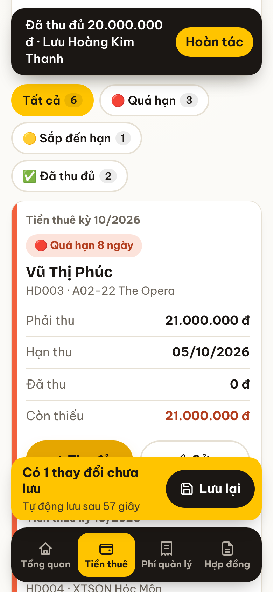
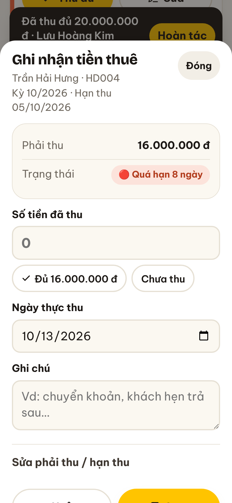

# Sổ Thuê Nhà

Web app theo dõi hợp đồng cho thuê nhà: tiền thuê thu vào, phí quản lý phải đóng, ai đã trả, ai còn nợ, khoản nào sắp đến hạn. Chữ to, nút to, dễ dùng cho người lớn tuổi.

Dữ liệu ban đầu lấy từ file Excel **“Quản lý hợp đồng thuê - Mrs. Hằng - 27.07.26.xlsx”** (7 hợp đồng, 47 kỳ tiền thuê, 17 kỳ phí quản lý).

<p>
  
  
  
  
</p>

## Tính năng

- **Tổng quan**: chọn tháng, xem phải thu / đã thu / còn phải thu, phí quản lý, tổng nợ đọng mọi kỳ, danh sách khách đang nợ và khoản sắp đến hạn.
- **Tiền thuê** và **Phí quản lý**: sổ theo tháng hoặc xem mọi kỳ còn nợ; lọc theo màu trạng thái; bấm **“Thu đủ”** một chạm hoặc **“Sửa”** để ghi số tiền, ngày thu, ghi chú; tạo kỳ thu cho tháng mới tự động theo hợp đồng.
- **Hợp đồng**: tiến độ thanh toán từng hợp đồng, cập nhật từng kỳ ngay tại đó, thêm / sửa hợp đồng.
- **Lưu**: thay đổi hiện thanh vàng “Có … thay đổi chưa lưu” với nút **Lưu lại**; không bấm thì app **tự lưu sau 1 phút**. Đóng hoặc ẩn trang cũng tự lưu.
- **Sao lưu / khôi phục** ra file `.json` (để chuyển sang máy khác), **khôi phục dữ liệu gốc** từ Excel.
- **Xuất PDF**: báo cáo tháng, toàn bộ sổ, danh sách hợp đồng (A4 ngang, font Be Vietnam Pro có dấu).
- Cỡ chữ Vừa / Lớn / Rất lớn; chạy được khi mất mạng; thêm được vào màn hình chính điện thoại.

Quy tắc màu giống file Excel: 🔴 quá hạn · 🟡 còn ≤ 3 ngày tới hạn · ✅ đã thu / đóng đủ · ⚪ chưa tới hạn.

> Lưu ý: dữ liệu nằm trong bộ nhớ trình duyệt của từng máy. Điện thoại và máy tính không tự đồng bộ với nhau — dùng **Tải file sao lưu** rồi **Chọn file sao lưu** để chuyển.

## Deploy lên Vercel

Không cần build. Thư mục phục vụ là `public/` (đã cấu hình trong `vercel.json`).

1. Đẩy repo lên GitHub.
2. Vào [vercel.com/new](https://vercel.com/new) → **Import** repo này.
3. **Framework Preset**: `Other`. Để trống Build Command. Bấm **Deploy**.

Hoặc dùng CLI: `npx vercel` (xem thử) và `npx vercel --prod` (bản chính thức).

## Chạy thử trên máy

```bash
npx serve public        # hoặc: python3 -m http.server 8080 --directory public
node --test             # kiểm tra số liệu khớp với file Excel
```

## Cấu trúc

```
public/
  index.html          giao diện + CSS
  js/data.js          dữ liệu gốc từ file Excel
  js/core.js          tính toán: trạng thái, tổng hợp, tạo kỳ thu (không đụng giao diện)
  js/app.js           màn hình, lưu dữ liệu, sao lưu
  js/pdf.js           xuất PDF
  vendor/             pdfmake 0.2.20 (MIT) + font Be Vietnam Pro (OFL)
  sw.js, manifest.webmanifest, assets/
tests/core.test.mjs   đối chiếu số liệu với Excel
vercel.json
```
